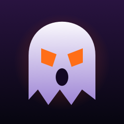
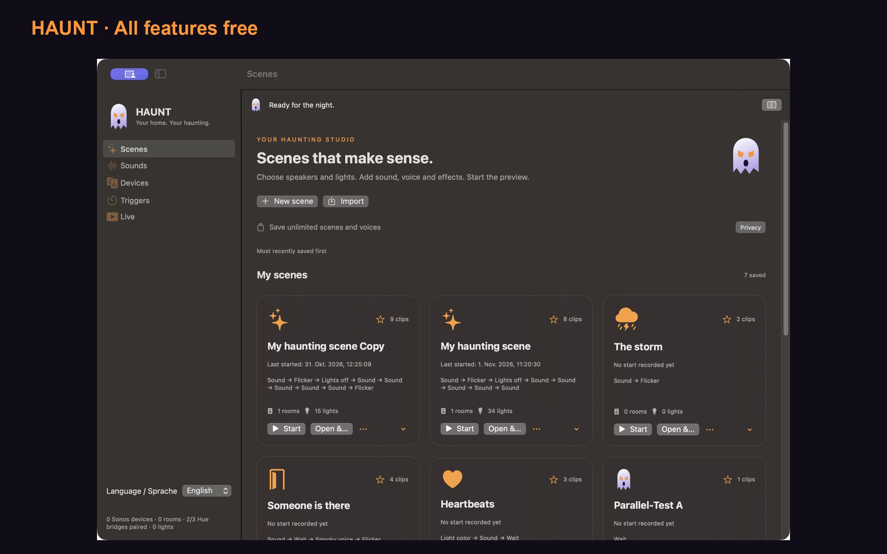
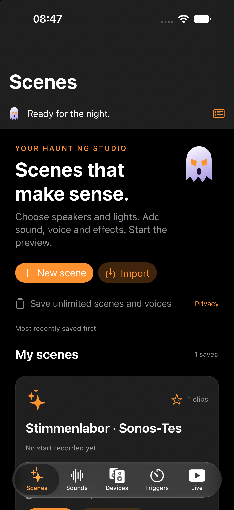
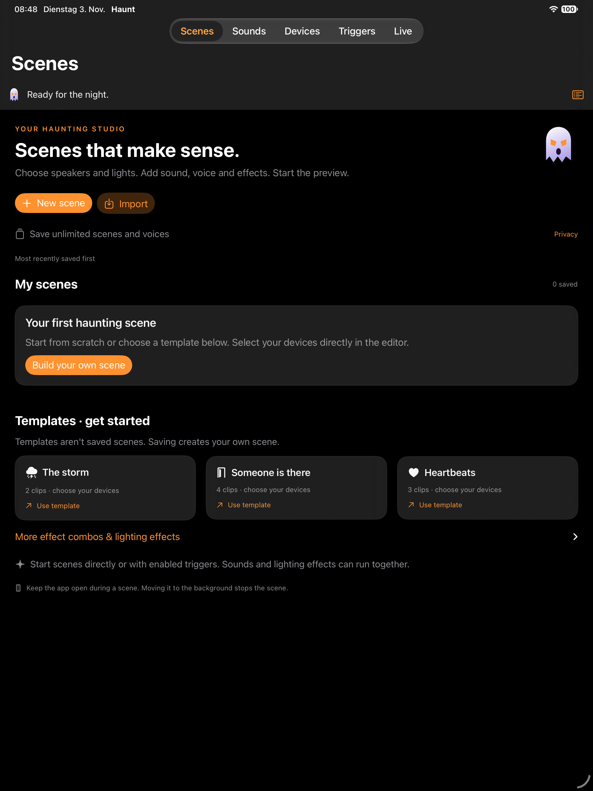
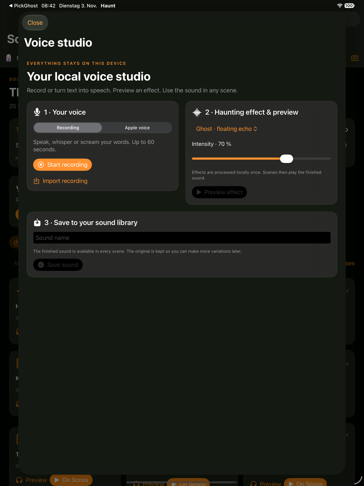
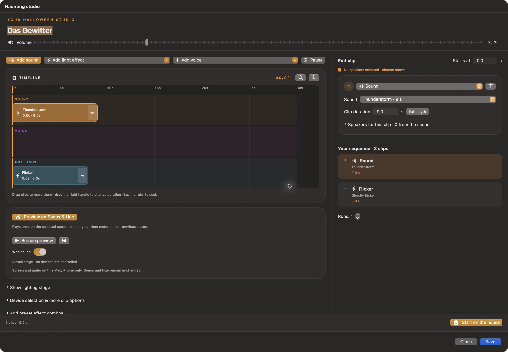

<p align="center"></p>

<h1 align="center">Halloween with Hue and Sonos</h1>
<p align="center"><strong>Haunt turns your home into a haunted house. You direct the sounds, voices and lights.</strong></p>
<p align="center">macOS · iPhone · iPad · English & German · All features free</p>

<p align="center">
<a href="#build-and-run">Build the app</a> · <a href="#your-first-scene">Create your first scene</a> · <a href="https://haunt-halloween-support.stefanhamann83.chatgpt.site/en/">Website & support</a> · <a href="SOUND_CREDITS.md">Sound credits</a>
</p>



A whisper from the hallway. A light that flickers as someone walks past. Thunder rolls through the speakers, then everything goes dark.

Haunt lets you put those moments on a timeline and play them through your Sonos speakers and Philips Hue lights. Choose your rooms, add sounds and lighting clips, and decide exactly when each part starts. Build a small surprise at the front door or a sequence across several rooms.

All features are free, including unlimited saved scenes, voice recordings and effect variations. There are no subscriptions, purchases, ads or AI services.

## What you can do

| Feature | What it gives you |
| --- | --- |
| Timeline editor | Arrange sound, voice and lighting clips, adjust duration, duplicate clips and copy or paste them. |
| Sonos playback | Choose rooms for a scene or individual clips, set volume and play imported audio or bundled horror sounds. |
| Philips Hue effects | Ghostly flicker, lightning, darkness and custom colors. Select individual lights, rooms or zones across multiple bridges. |
| Local voice studio | Record your voice or use installed Apple voices, preview horror effects and save sounds to reuse in any scene. |
| Triggers | Schedules, repeat intervals and supported Hue motion sensors, buttons, contacts and other inputs. |
| Scene library | Favorites, most recently saved ordering, import and export, plus templates to get started. |
| Concurrent scenes | Run scenes on separate devices and pause or stop them individually. |
| Device tools | Discover Sonos and Hue, pair each bridge with its physical button, identify a lamp with a brief flash and inspect sensor events. |

## A look inside

### Your scenes on iPhone and iPad

<table><tr><td width="35%"></td><td width="65%"></td></tr></table>

### The local voice studio

Record a whisper, choose an installed Apple voice or import a recording. Try a ghost echo, a deeper demonic voice, cursed radio or reverse playback. Save the finished sound and create more variations from the original recording.



### Sounds and lights on one timeline



These are actual app views. Screenshots show different stages of development; the current source has all purchase gates removed.

## Your first scene

1. Connect your Mac, iPhone or iPad to the network containing your Sonos speakers and Hue bridges.
2. Open **Devices**, allow local network access and discover your devices. Pair each Hue bridge by pressing its physical link button, then confirm in Haunt.
3. Open **Scenes**, create a scene or choose a template, and select speakers and lights.
4. Add sounds, saved voices and lighting effects. Arrange the clips on the timeline. Preview locally, or choose the action that starts playback on your home devices.
5. Save the scene. Add a trigger if you want it to start on a schedule or a supported Hue event, then enable the individual trigger and global automation.

Stopping a scene attempts to restore the previous lighting and Sonos state. Device errors appear in the scene log.

## What you need

- macOS 14 or later, or iOS/iPadOS 17 or later.
- Sonos speakers reachable on the local network for room playback.
- A Philips Hue bridge and compatible lights for lighting effects. Multiple bridges are supported.
- Compatible Hue accessories for sensor or button triggers. MotionAware areas require a compatible Bridge Pro and configuration in the Hue app; ordinary bulbs do not expose a motion input on their own.

**Keep Haunt open while scenes or triggers are running.** The Mac must remain awake. On iPhone and iPad, moving the app to the background stops playback; persistent background automation is not provided. Network playback is not sample accurate. Bonded Sonos surrounds and subwoofers follow their main room.

## Build and run

Install the full Xcode application and [XcodeGen](https://github.com/yonaskolb/XcodeGen). This repository includes the Swift package and the project generator configuration; generated Xcode projects are ignored.

```sh
git clone https://github.com/sthamann/Halloween-with-Hue-and-Sonos.git
cd Halloween-with-Hue-and-Sonos
xcodegen generate
open HalloweenSonos.xcodeproj
```

Select **HauntMac** or **HauntIOS**. For your own signed build, select your Apple development team and change the example bundle identifier under Signing & Capabilities. No signing certificates, profiles or account credentials are included.

Build for the iPhone simulator:

```sh
./script/build_ios.sh simulator
```

Build the Mac app without distribution signing:

```sh
xcodebuild -project HalloweenSonos.xcodeproj -scheme HauntMac \
  -destination 'platform=macOS' -derivedDataPath DerivedData \
  CODE_SIGNING_ALLOWED=NO build
```

For dependable local network and Keychain behavior, run a consistently signed build using your own Apple development identity. The unsigned build is useful for compilation and UI development.

Run the core tests:

```sh
swift test
```

Live Hue checks are opt in through environment variables and are skipped by default. The app has been exercised locally on macOS and in iPhone/iPad simulators. Hardware behavior depends on your network and accessories. App Store build 1.0 (3) was resubmitted on November 3, 2026 and is awaiting review; there is no public store download yet.

## How it works

The SwiftUI app shares a Swift core across Apple platforms. Sonos control and Hue communication stay on the local network. For playback, a local HTTP server serves selected audio files to the Sonos speakers. Hue credentials are stored in the Apple Keychain.

Recordings, voice effects and speech synthesis use local Apple audio frameworks and installed voices. Scene files and saved sounds live on the device. Exported scene packages include the selected custom audio, but do not include Hue credentials. There is no developer cloud account, analytics service or remote AI endpoint.

| Directory | Contents |
| --- | --- |
| `Sources/HalloweenApp` | SwiftUI screens, bundled sounds and app resources |
| `Sources/HalloweenCore` | Device discovery, playback, Hue integration, timelines, triggers and persistence |
| `Tests` | Core tests and hosted iOS voice recording tests |
| `Config` | App metadata, entitlements and icons |
| `script` | Build helpers, icon generation and sound bundle tooling |

## Feedback and contributions

Found an issue? Open a GitHub issue with your platform, Haunt build, device models, what you expected and what happened. Remove bridge keys, recordings, private network inventories and personal information from attachments.

## Credits and licensing

Haunt is an independent project by Stefan Hamann. Sonos and Philips Hue are compatibility references; the project is not affiliated with or endorsed by either company.

The bundled third party recordings use **CC0 1.0 Universal**. Authors, original sources and processing notes are listed in [SOUND_CREDITS.md](SOUND_CREDITS.md) and the bundled sound catalog. Original generated effects are identified separately.

The software source is publicly available. No separate software license is granted by this repository. Third party audio retains its stated CC0 terms.
